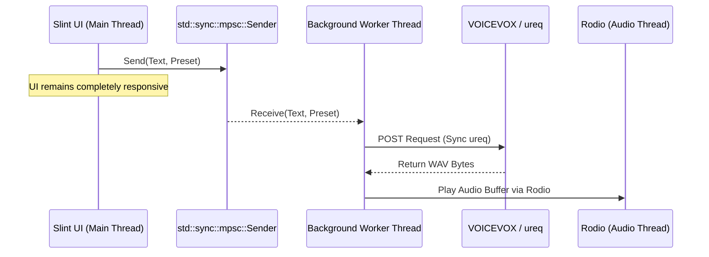
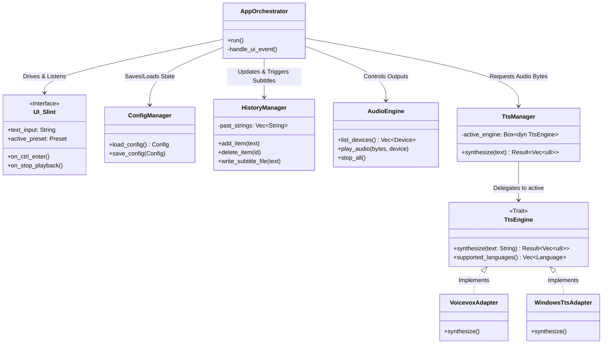

# voice_string_chatter

## Purpous
The purpus of this program is voice chatting inputting with string.
In other words, we want you to enjoy voice chat even if, for some reason, you are unable to speak.

## Requirements(for develop)

- In main, pressing Ctrl + Enter after typing some string is trigger to start synthesizing voice and play synthesized voice.
- Outputting must be flexible. It can outputing as a mic device, or inputting to virtual audio cable.
- Simple UI is maximizes UX for those who use it extensively.
- Make with Rust.
- Switching and Config TTS models should be possible both instantly and intuitively.
- It should be possible too operate it using both keyboard and mouse.
- It should be flexible enough to work with any TTS or way to connect(VOICEVOX local APIs, voicevox_core, windows TTS, Google AI TTS API, Gnuspeech etc...).Even if it is not possible to address every requirement, it is necessary to employ appropriate abstractions, develop modules independently, and ensure extensibility.
- Language of input should be abstracted and must support at least Japanese and English.(The string currently being played back is also output, allowing it to be used for applications such as subtitles for streaming.)
- It would be better to save TTS models and config presets.
- Persistence of Config.
- Can stop playing, play back and delete past string easily.

## Technology Selection

To meet the requirements with maximum performance, minimal resource usage, and clean architecture, the following libraries and concurrency model have been selected:

### Selected Libraries

| Library / Crate | Purpose & Role | Directly Addresses Requirement |
| :--- | :--- | :--- |
| `slint` | Modern, lightweight, declarative UI framework with native Rust bindings. | "Simple UI", "Operate using keyboard & mouse", "Ctrl+Enter trigger", "Switching TTS models instantly". |
| `rodio` | High-level audio playback library that manages audio streams, buffers, and active playback controls (play/stop/pause). Internally encapsulates and manages `cpal` for native hardware device selection and playback. | "Outputting must be flexible", "Can stop playing, play back easily", "Outputting must be flexible (mic device, virtual audio cable)". |
| `ureq` | Minimalist, synchronous HTTP client. Fast compile times, tiny dependency tree, and a simple API. Replaced heavy async clients like `reqwest`. | "VOICEVOX local APIs, Google AI TTS API". |
| `tts` | Native OS TTS wrapper (uses Windows SAPI). Excellent for simple offline English/Japanese TTS with zero setup. | "windows TTS", "English and Japanese abstraction". |
| `serde` & `serde_json` | Serialization/deserialization for saving/loading profiles, presets, and history. | "Save TTS models and config presets", "Persistence of Config". |
| `directories` | Finds standard, platform-specific config directories (e.g., `AppData` on Windows) to store persistent configurations. | "Persistence of Config". |

### Concurrency Model: Thread-Based, No Async Runtime

We purposefully **avoid an async runtime** (like `tokio` or `smol`) because of their heavy dependency footprint and complex future lifetimes. Instead, we use:
- `std::thread`*to spawn lightweight background worker threads.
- **`std::sync::mpsc`** (multi-producer, single-consumer channels) to send TTS synthesis tasks from the UI thread to the worker threads without blocking.
- **`rodio`**'s internal audio player threads to handle continuous, glitch-free audio rendering.

---

## Module Architecture & Relationships

To fulfill the extensibility requirement ("employ appropriate abstractions, develop modules independently, and ensure extensibility"), the application is decomposed into six specialized, loosely-coupled modules:

### Module Roles & Responsibilities

1. UI (`src/ui/` via Slint):** Coordinates layout rendering, user mouse/keyboard focus, and event signals (like `Ctrl+Enter`).
2. App Orchestrator (`src/app.rs`):** The primary coordinator. Listens to UI triggers, pushes background worker tasks, writes subtitles, and tells the audio engine to play or stop.
3. TTS Manager (`src/tts/`):** Defines the `TtsEngine` trait. Standardizes English and Japanese text translation to audio byte buffers via swappable modules (`VoicevoxAdapter`, `WindowsTtsAdapter`).
4. Audio Engine (`src/audio.rs`):** Manages connection to audio hardware devices (`cpal`) and controls active playback streams/sinks (`rodio`).
5. Config Manager (`src/config.rs`):** Handles file persistence (JSON/TOML) in the proper OS system path via `serde` and `directories`.
6. History Manager (`src/history.rs`):** Manages spoken records, replay commands, and exports the live subtitle file (`subtitles.txt`) for OBS overlay integration.
